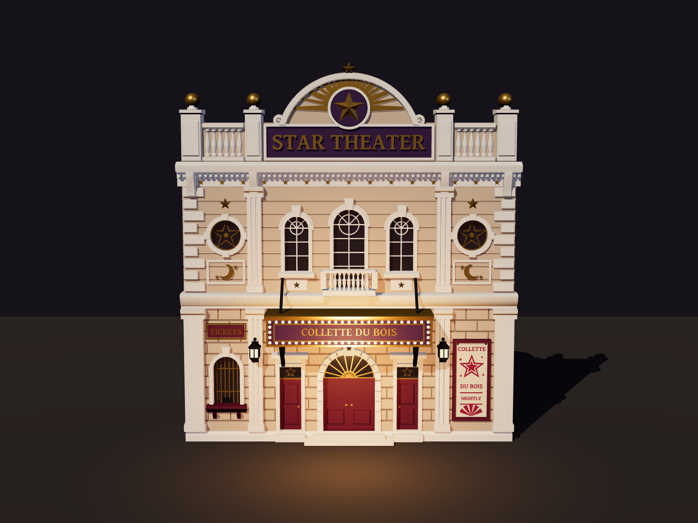
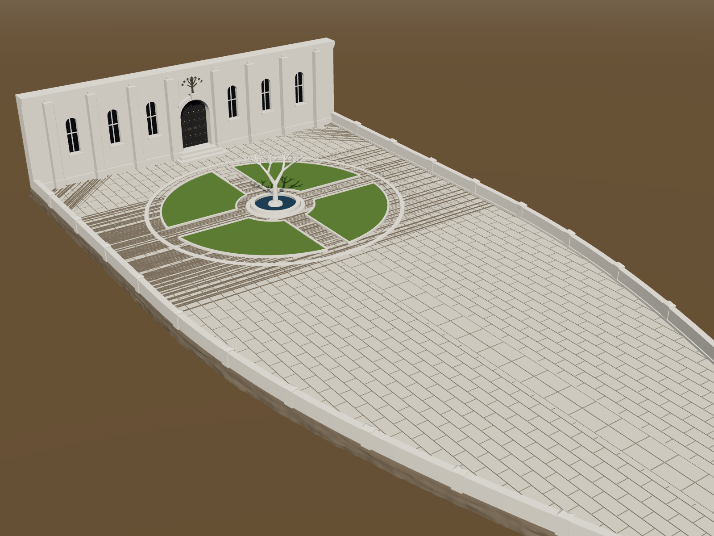

# T-pose orbit video

A 10 s, 1080p30 video of a camera orbiting a T-posed human figure, made entirely from code.

- `scene/index.html` builds the figure procedurally in three.js (no downloaded models): each body part is a lathe-revolved profile or sphere, positioned by hand-picked joint coordinates.
- `render.mjs` loads the page in headless Chromium, steps the camera one frame at a time via `window.renderAt(t)`, screenshots each frame, and pipes the PNGs into ffmpeg (H.264).

```sh
npm install
pip install imageio-ffmpeg   # or set FFMPEG=/path/to/ffmpeg
node render.mjs              # -> out/t-pose-orbit.mp4
```

# Star Theater facade (Malifaux terrain)

A 3D-printable front of Collette Du Bois' Star Theater, modelled entirely in code with [manifold-3d](https://github.com/elalish/manifold) CSG. The output is one watertight solid.



- `model/build.mjs` builds the facade and writes:
  - `out/star-theater.stl`: the model, in millimetres at 32 mm scale. It is 195 × 218 × 33 mm and already sits in print orientation: on its back, face up. Everything is modelled as relief rising off the flat back, so it prints without supports. The only overhangs are short bridges on the balcony rail, balusters and marquee brackets.
  - `out/brace.stl`: an optional triangular buttress (90 × 36 × 4 mm). Print two or three and glue them to the back so the wall stands on its own.
  - `out/star-theater.bin`: the same mesh, with each triangle tagged by paint group, for the previews.
- `model/check-stl.mjs out/star-theater.stl` re-imports the STL and reports connected components. It should say `components 1`.
- `scene/theater.html` is the three.js preview. `model/shots.mjs` renders stills from it (`out/renders/`), and `node render.mjs out/star-theater-orbit.mp4 /scene/theater.html` renders the orbit video.

```sh
npm install
node model/build.mjs
node model/check-stl.mjs out/star-theater.stl
```

What's on it: a rusticated ground floor with arched double doors under a sunburst fanlight, two side doors, a barred ticket window, a "COLLETTE" poster, and wall lanterns. Above that is a bulb-lit marquee reading "COLLETTE DU BOIS", hung from tie rods and brackets. The upper floor has arched windows, a balcony, and star-traced oculus windows over crescent-moon panels. At the top are a dentil cornice with a frieze of stars, a "STAR THEATER" attic sign between balustrades and ball finials, and a sunburst pediment with a faceted star medallion.

To fit a smaller print bed, scale it uniformly in the slicer. At 90% it is 176 × 196 mm. If you print it upright instead, you'll need supports under the marquee and cornices.

# Minas Tirith: the Court of the Fountain (gaming tile)

The summit of Minas Tirith as a tile for 32 mm minis. It covers the Court of the Fountain and the long prow, with a front wall of the Citadel on the cut edge. Like the theater, it's built with manifold-3d CSG as one watertight solid.



- `node model/citadel.mjs` writes `out/citadel.stl`, plus `out/citadel.bin` and `out/citadel.json` for the preview.
- **Size:** 953 × 378 mm. The paved deck is 9 mm above the table. Every edge drops to the table as a stepped rock face, so anything off the tile is a fall. The parapet is 11 mm tall, the White Tree about 58 mm, and the Citadel wall 100 mm above the deck.
- **In the courtyard:** concentric paving, four raised lawns split by cross paths, a kerbed ring, and a fountain basin. The White Tree stands on an island in the middle. Every branch is at least ~33° above horizontal, so it prints without supports.
- **The prow:** running-bond paving, a processional path of large slabs down the middle, and a lookout dais with an inlaid star at the tip. It's edged by a coped parapet with capped posts every ~70 mm.
- **Citadel front:** a buttressed wall with tall arched windows, great studded double doors up a flight of steps, and the White Tree and Seven Stars carved above them.
- **Printing:** it's meant to be scaled and cut into pieces in the slicer. It already sits flat on its base.
- **Preview:** `scene/viewer.html?m=citadel` is the preview page. Render stills with `PAGE=/scene/viewer.html QUERY='?m=citadel' node model/shots.mjs out/renders name:painted:az:el:dist[:tx:ty:tz]`.
